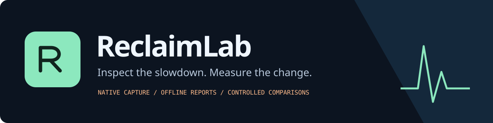

[](https://github.com/HamWebDevs/ReclaimLab/actions/workflows/tests.yml)

[](LICENSE)


**A performance flight recorder and experiment notebook for older laptops.**

Record a slowdown while doing your normal work. See scheduling delays alongside native CPU, memory and available pressure counters. Change one thing, record again, and compare the measurements in a self-contained interactive report.

No account, background service, automatic tuning, telemetry or runtime dependencies. Capture supports **Windows and Linux**; analysis and reports also work on macOS.

[Quick start](#quick-start) · [How it works](docs/methodology.md) · [Commands](docs/commands.md) · [Counter coverage](docs/counters.md) · [DevPocket integration](docs/devpocket.md)

## Quick start

From a checkout:

```bash
python -m pip install .
reclaimlab doctor
reclaimlab record --seconds 60 --label before --workload "usual browser task" --output before.jsonl
reclaimlab report before.jsonl --output before.html
```

Open `before.html` in your browser. The report works offline and makes no network requests. You can also run directly with `python -m reclaimlab` from this checkout. Python 3.10+ is required. Nothing is published to PyPI; install from this source.

Try the interface without collecting any device data:

```bash
reclaimlab demo --output demo.html
```

Demo data is clearly marked synthetic throughout the report. It is not evidence of a real laptop or a measured speedup.

## Make a change you can actually evaluate

Repeat the same task after changing one thing:

```bash
reclaimlab record --seconds 60 --label after --workload "usual browser task" --output after.jsonl
reclaimlab compare before.jsonl after.jsonl --output experiment.html
```

The comparison checks coarse hardware/platform compatibility, sampling rate, duration, declared workload, power state, trace completeness and recorder overhead. It uses a seeded block bootstrap to describe uncertainty around the difference in p95 timer wake delay. Mismatched or insufficient captures produce **not comparable**, rather than a confident improvement claim.

A lower measured delay does not establish that your attempted change caused it. Repeat captures, keep the task consistent and consider an ABAB crossover. [Read the methodology](docs/methodology.md).

## Inside a report

| View | What it gives you |
| --- | --- |
| **Timeline** | Aligned wake-delay, CPU and memory charts; zoom controls; optional markers; evidence cards; capture-quality warnings. |
| **Evidence** | Duration-weighted counter averages and coverage, delay episodes and optional process-name evidence. Missing counters remain unknown. |
| **Experiment** | Before/after metrics, a descriptive bootstrap interval, compatibility blockers and workload-context changes. |

Large timelines retain bucket endpoints and resource/delay extremes for bounded chart geometry. Statistics use the original selected records. Zoom controls change the chart only; the UI states this explicitly. Imported labels/process names are inserted as text, and embedded JSON is escaped to prevent script injection.

## Useful capture options

```bash
# Mark a perceived pause by typing a label and pressing Enter
reclaimlab record --interactive --output marked.jsonl

# Explicitly opt in to names/PIDs and available per-process CPU/RSS evidence
reclaimlab record --processes --output processes.jsonl

# Inspect the sample records around the first exact marker label
reclaimlab analyze marked.jsonl --around "video froze" --radius 5 --json
```

Process collection is off by default. No command lines, window titles, browser history, hostnames, usernames, network addresses or hardware serial numbers are intentionally collected. Labels and process names can still be private; review reports before sharing.

## What the measurements mean

- **Timer wake delay** is the Python probe's sleep/scheduling lateness. It is not measured GUI input lag or game frame time.
- **Resource overlap** identifies clues during delayed records. It does not establish a root cause.
- **Low available memory alone** is weaker evidence than low headroom plus observed swap traffic or memory pressure.
- **High temperature alone** does not prove throttling. The Linux backend reports direct counter growth only when that counter is available.
- **Observer overhead** is measured, not assumed negligible. Capture quality flags excessive recorder CPU use and slow sampling.
- **Hardware signatures** are deliberately coarse and non-identifying. Matching signatures do not prove two traces came from the same physical machine.

Linux captures `/proc` CPU/memory, available PSI, swap and block-device counters, plus optional CPU-related thermal counters. Windows uses direct native APIs for CPU, immediately available memory, commit headroom, power status and optional process evidence. Windows PSI, disk-busy and thermal values remain unavailable in v0.1. [Exact coverage and limits](docs/counters.md).

## Connect it to DevPocket

ReclaimLab is also an optional **DevPocket API v1 plugin**. Install both projects in the same environment, then:

```bash
devpocket plugins enable reclaimlab
devpocket run reclaimlab --input '{"trace":"before.jsonl"}' --format sarif
devpocket serve --root /absolute/path/to/project --plugin reclaimlab
```

The plugin reads saved traces; it does not start recording or tune the machine. Findings work with DevPocket checks, baselines, SARIF and MCP. [Integration guide](docs/devpocket.md).

## Development

```bash
python -m unittest discover -s tests -v
```

Tests cover native counter maths, counter reset/PID reuse, trace validation, missing measurements, evidence rules, comparison blockers, reproducible intervals, report injection boundaries and JavaScript interactions. Windows/Linux CI additionally exercises real short native captures. The GitHub matrix covers Python 3.10, 3.12 and 3.14 on Windows, Linux and macOS; macOS live capture is intentionally unsupported.

See [CONTRIBUTING.md](CONTRIBUTING.md) and [SECURITY.md](SECURITY.md). Windows 8.1 compatibility has not been verified; use an interpreter supported by your OS. This is a diagnostic project, not a promise that software can overcome every hardware limit.

---

MIT licensed · Built by [HamWebDevs](https://github.com/HamWebDevs)
